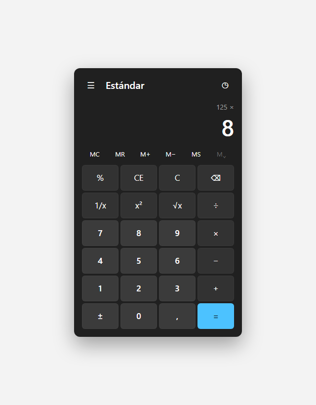

# Calculadora estilo Windows

Réplica web del modo **Estándar** de la calculadora de Windows 11, hecha con **Angular 21** y Bootstrap 5. Funciona con el ratón y con el teclado, guarda valores en memoria y muestra *Error* en las operaciones inválidas en lugar de romperse.

Proyecto de la carrera de Ingeniería de Sistemas, Universidad El Bosque.



## Funcionalidades

- Suma, resta, multiplicación y división, con operaciones encadenadas: `2 + 3 ×` calcula `5` antes de seguir, como en Windows.
- Funciones de un solo número: porcentaje, inverso (`1/x`), cuadrado (`x²`), raíz cuadrada (`√x`) y cambio de signo (`±`).
- Borrado: `CE` limpia la entrada, `C` reinicia todo y `⌫` borra el último dígito.
- Memoria: `MS` guarda, `M+` y `M−` suman y restan, `MR` recupera y `MC` borra. `MC` y `MR` se deshabilitan mientras la memoria está vacía.
- Muestra *Error* al dividir entre cero, al pedir la raíz de un negativo o el inverso de cero, y se recupera al escribir un número nuevo.
- Redondea a 10 decimales para evitar resultados como `0.30000000000000004`.
- Encima del número se ve la operación pendiente, por ejemplo `125 ×`.

### Atajos de teclado

| Tecla | Acción |
| --- | --- |
| `0`–`9`, `.` o `,` | Escribir el número |
| `+` `-` `*` `/` | Operadores |
| `Enter` o `=` | Resultado |
| `Backspace` | Borrar el último dígito |
| `Escape` | `C` (borrar todo) |
| `Supr` | `CE` (borrar la entrada) |
| `%` | Porcentaje |

## Tecnologías

- Angular 21 con componentes *standalone* y TypeScript
- Bootstrap 5.3 (por CDN) para la rejilla de botones
- Vitest con jsdom para las pruebas unitarias

## Requisitos

- Node.js 20.19 o superior (probado con Node 24)
- npm 10 o superior
- Conexión a internet, porque Bootstrap se carga desde un CDN

## Instalación y ejecución

```bash
git clone https://github.com/P2X4A/calculadoraFinalWindows.git
cd calculadoraFinalWindows
npm ci
npm start
```

Abre `http://localhost:4200/`.

Para generar la versión de producción:

```bash
npm run build
```

Los archivos quedan en `dist/calculadora/browser`.

## Pruebas

```bash
npm test -- --watch=false
```

Hay 16 pruebas: operaciones básicas y encadenadas, decimales, errores, funciones de un número, borrado, memoria, teclado y el estado de los botones `MC` y `MR`.

## Estructura

```text
src/app/
├── app.ts / app.html                 # Compone navbar, calculadora y footer
├── contenidocomponent/
│   ├── contenidocomponent.ts         # Estado y lógica de la calculadora
│   ├── contenidocomponent.html       # Pantalla, memoria y teclado
│   ├── contenidocomponent.css        # Tema oscuro estilo Windows 11
│   └── contenidocomponent.spec.ts    # Pruebas unitarias
├── navbarcomponent/
└── footercomponent/
```

Toda la lógica vive en `Contenidocomponent`. La pantalla se guarda como texto para poder escribir varios dígitos y el punto decimal. Los operandos se guardan como números, y dos banderas (`esperandoNumero2` y `mostrandoResultado`) deciden si el siguiente dígito continúa el número o empieza uno nuevo.

## Autor

Sergio Parra · [github.com/P2X4A](https://github.com/P2X4A)
